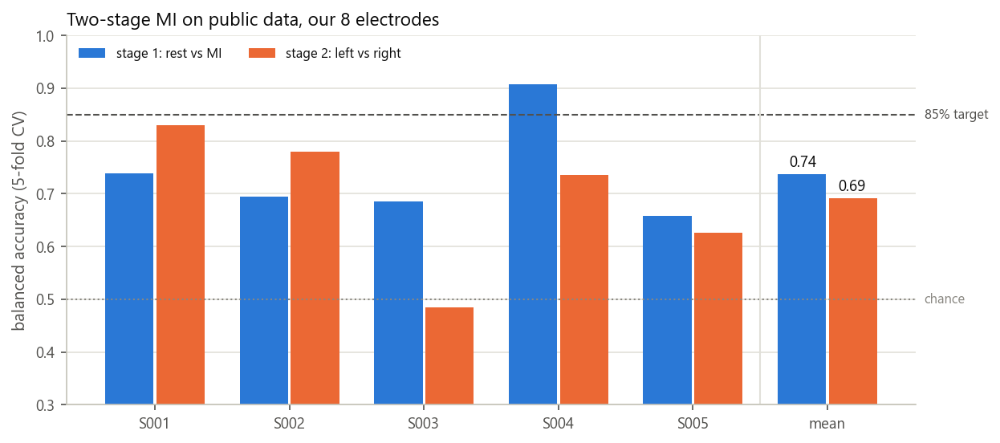
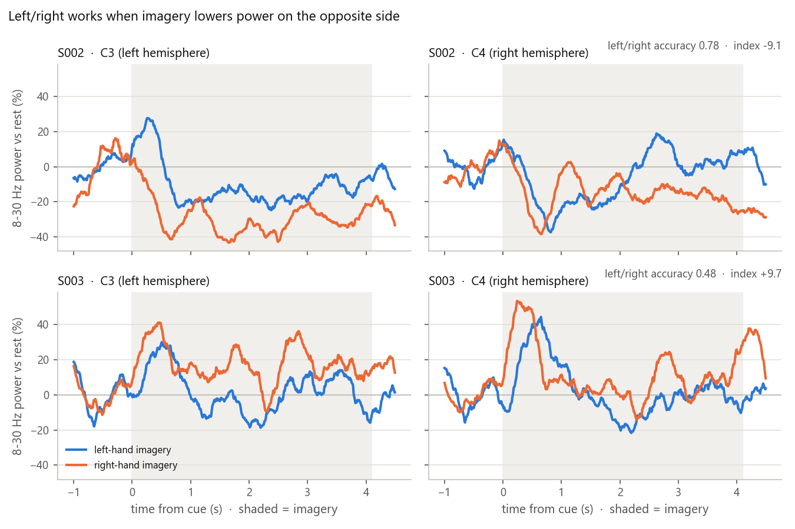
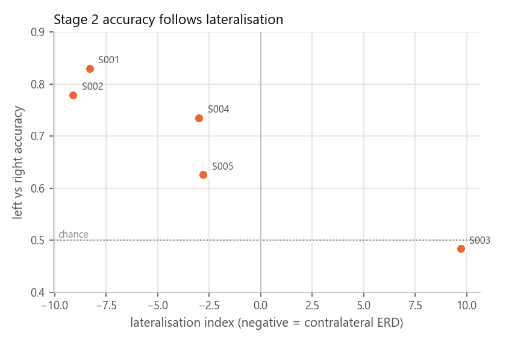

# MI pipeline validation on public EEG (PhysioNet)

*biopipe two-stage motor-imagery model, checked on 9 Nov 2026.*

## Why
We have no motor-imagery (MI) recordings of our own yet, and every test must use real data. So
before recording, the MI pipeline was run on a public MI dataset, through exactly the code the
app's **Train** tab uses.

## Data
- **PhysioNet EEG Motor Movement/Imagery Dataset 1.0.0** (BCI2000 system), subjects
  **S001–S005**: the first five, not hand-picked.
- Runs 4, 8 and 12: imagine opening and closing the **left** or **right** fist for 4.1 s, with
  4.2 s of **rest** between cues.
  - Per subject: about 45 rest, 22 left and 23 right trials, in one session.
- Recorded on 64 channels at 160 Hz. Only **our 8 headset sites** are used:
  Fz FC5 FC6 C3 Cz C4 P3 P4.
- 15 EDF files (`S001R04.edf` … `S005R12.edf`, 37 MB) in `data/`. They are not in git and can
  be downloaded again from `https://physionet.org/files/eegmmidb/1.0.0/`.

## Method (the app's own code)
- **Same processing as the app's Train tab:**
  - causal 8–30 Hz filter, the same one Live uses;
  - 2 s windows every 0.5 s, after dropping the first 0.4 s of each cue;
  - trial-grouped, class-stratified 5-fold cross-validation;
  - scored by balanced accuracy.
- **Two-stage model**, each stage scored on its own:
  - **Stage 1:** rest vs MI, i.e. is the person imagining at all?
  - **Stage 2:** left vs right, trained on MI windows only.
  - **Combined:** the output is "rest" unless stage 1 says MI; then stage 2 picks the side.
  - Each stage takes the window's 8×8 covariance → Riemannian tangent space at the training
    mean (36 numbers) → class-balanced logistic regression.
- **Chance level** is 0.50 per stage and 0.33 for rest/left/right.
  - With these trial counts, beating chance at p < 0.05 needs ≥ 0.59 for stage 1 and ≥ 0.62
    for stage 2 (binomial test).

## Results (mean of 5 subjects)

| Model | Stage 1: rest vs MI | Stage 2: left vs right | Overall: rest / left / right |
|---|---|---|---|
| Old app model: one 3-class CSP + LDA | – | – | 0.55 |
| Two-stage, CSP + LDA | 0.74 | 0.66 | 0.54 |
| **Two-stage, Riemann + logistic regression (new default)** | **0.74** | **0.69** | **0.58** |
| Same model, trained on 2 runs, tested on the unseen 3rd | 0.71 | 0.69 | 0.56 |

| Subject | Stage 1 | Stage 2 | Overall | Lateralisation index |
|---|---|---|---|---|
| S001 | 0.74 | **0.83** | 0.63 | −8.3 |
| S002 | 0.69 | 0.78 | 0.58 | −9.1 |
| S003 | 0.69 | 0.48 | 0.46 | +9.7 |
| S004 | **0.91** | 0.74 | 0.74 | −3.0 |
| S005 | 0.66 | 0.63 | 0.48 | −2.8 |

- **Stage 1** beats chance for all five subjects. **Stage 2** beats it for four; S003 is at
  chance.
- Testing on a run the model never saw costs only about 0.03 on stage 1, so the model isn't
  memorising one run.
- **The live tab gives the same numbers.** Replaying a held-out run through the Live tab's
  engine gave the same probabilities as offline, sample for sample.

### Why left vs right works for some people and not others
- Imagining one hand lowers mu/beta power over the **opposite** hemisphere. This drop is the
  ERD (event-related desynchronisation): right hand → C3, left hand → C4.
- The **lateralisation index** measures how strongly a person shows this pattern:
  - It is [C3 − C4 during right-hand imagery] − [C3 − C4 during left-hand imagery], using the
    ERD % averaged over 0.5–4 s.
  - Negative means the textbook pattern.
- **Stage 2 accuracy follows this index almost in rank order.** S003's power rose instead of
  dropping, so no classifier can separate the hands for them.

*(The short rise just after each cue is the brain's visual response to the cue appearing.)*

### Window length and electrodes (two-stage, Riemann)

| Variant | Stage 1 | Stage 2 |
|---|---|---|
| 1 s window | 0.68 | 0.64 |
| **2 s window (default)** | **0.74** | **0.69** |
| 3 s window | 0.77 | 0.70 |
| All 64 electrodes | 0.82 | 0.62 |
| Only C3 Cz C4 | 0.63 | 0.55 |
| Fz FC5 FC6 C3 C4 CP5 CP6 Pz | 0.71 | 0.70 |

- **2 s is the default window.** 3 s gains 1–3 points but adds 1 s of delay to every decision.
- **Our 8 electrodes are a good choice:**
  - 64 channels help rest vs MI, but with only ~22 trials per hand they overfit left vs right.
  - Three channels are clearly not enough.
- The CP5/CP6/Pz variant scores the same as our montage, so MI gives no reason to move
  electrodes.

## What this means for the 85% target
- **On this dataset, 85% is reached by individuals, not on average.**
  - S004 reaches 0.91 on stage 1, and S001 0.83 on stage 2.
  - These are naive users with no feedback, one session and ~22 trials per hand. This is
    typical for this dataset.
- **Whether left vs right works depends first on the person producing a lateralised ERD.** Once
  we have our own recordings, check the C3/C4 ERD before tuning models.
- **Levers for our own data, in order:**
  1. **More trials:** ≥ 40 per hand, over several sessions.
  2. **Kinesthetic imagery:** feel the squeeze rather than picture it.
  3. **Practice with Live-tab feedback.**
  4. **Steady electrode contact.**
  5. Only then, longer windows or averaging the last few decisions, if the delay is acceptable.
- **The planned EMG wrist clench will replace stage 1.** Stage 2 (left vs right) is then the
  number that matters.

## Limits
- Only five subjects, one session each.
- A different amplifier and reference from our Cyton. Our ear reference adds a strong signal
  common to all channels.
- Few trials per class.
- Treat the numbers as a check that the pipeline works on real MI, not as a prediction for our
  headset.

## Files and how to reproduce
- **`validate_mi_physionet.py`** has an EDF reader and calls the app's `train_mi` and
  `TwoStageMI`.
  - `python -I validate_mi_physionet.py` runs everything (~5 min) and writes `results/`.
  - Add `--figures` to redraw the figures only.
- **`results/results.json`**: every score, per subject and per stage, with per-class
  precision/recall, chance thresholds and ERD values.
- **`results/*.png`**: the figures above.
- `results/erd_curves.npz`: the ERD curves behind the figures.

## References
- Schalk G, McFarland DJ, Hinterberger T, Birbaumer N, Wolpaw JR. BCI2000: a general-purpose
  brain-computer interface (BCI) system. *IEEE Trans Biomed Eng* 51(6):1034–1043, 2004.
- Goldberger AL et al. PhysioBank, PhysioToolkit, and PhysioNet. *Circulation*
  101(23):e215–e220, 2000. Dataset licence: ODC-By 1.0.
- Barachant A, Bonnet S, Congedo M, Jutten C. Multiclass brain-computer interface
  classification by Riemannian geometry. *IEEE Trans Biomed Eng* 59(4):920–928, 2012.
- Pfurtscheller G, Lopes da Silva FH. Event-related EEG/MEG synchronization and
  desynchronization: basic principles. *Clin Neurophysiol* 110(11):1842–1857, 1999.
- Combrisson E, Jerbi K. Exceeding chance level by chance: the caveat of theoretical chance
  levels in brain signal classification and statistical assessment of decoding accuracy.
  *J Neurosci Methods* 250:126–136, 2015.
